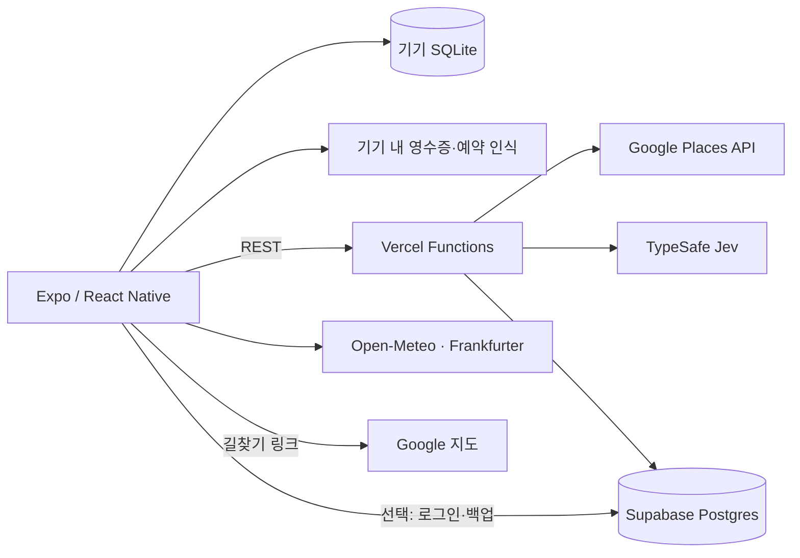

# Escale: 여행 계획·경비·기록 모바일 앱

여행 일정과 예약, 그날의 이동, 여러 통화로 쓴 경비와 동행자 정산, 다녀온 나라의 기록을 한 앱에서 다루는 프로젝트입니다. Expo/React Native 앱과 Vercel 서버 함수, Supabase를 연결했습니다.

| 계획 | 오늘 | 돈 | 여권 |
|---|---|---|---|
|  |  |  |  |

## 해결하려던 문제

직접 오사카 여행을 준비하면서 시작한 프로젝트입니다. 일정은 메모 앱, 예약은 메일과 캡처, 길찾기는 지도 앱, 경비는 가계부에 흩어져 있어서 여행 중에 "지금 어디로 가야 하고, 돈은 얼마나 남았는지"를 바로 알기 어려웠습니다. 엔화로 쓴 돈을 원화로 환산해 동행자와 나누는 정산도 여행이 끝난 뒤 다시 계산해야 했습니다. 그리고 여행이 끝나면 준비에 들인 기록이 아무 데도 남지 않았습니다.

그래서 여행 전에는 준비, 여행 중에는 다음 행동과 남은 예산, 귀국 후에는 다녀온 기록이 남도록 하나의 흐름으로 묶었습니다.

## 사용자 흐름

1. 여행지·기간·통화·동행자를 정해 여행을 만듭니다.
2. 계획 탭에서 시간표·캘린더·지도·예약을 같은 날짜 기준으로 정리합니다.
3. 여행 중 오늘 탭에서 다음 일정, 길찾기, 날씨, 환율, 오늘 쓴 돈을 확인합니다.
4. 돈 탭에서 지출을 기록하고 동행자별 분담과 정산 결과를 확인합니다.
5. 귀국일에 여행을 마쳤다고 확인하면 여권 탭에 나라별 도장이 남습니다.

## 구현 구조



| 구성 | 역할 |
| --- | --- |
| Expo · React Native · TypeScript | 계획·오늘·돈·여권 화면, iOS/Android 실행 |
| expo-sqlite | 여행·일정·예약·지출을 기기에 저장. 로그인 없이 전체 흐름 동작 |
| 로컬 네이티브 모듈 | 영수증·예약 사진의 글자를 기기 안에서 인식 |
| `src/domain` 공유 도메인 | 통화·환율·분담·시간대·예약 계산을 앱과 서버가 함께 사용 |
| Vercel Functions (`api/`, `server/`) | 장소 검색·추천, 예약 문구 분석, 호출 한도와 인증 확인 |
| Google Places API · TypeSafe Jev | 장소 후보 조회와 후보별 적합도 판단 |
| Supabase (Auth · Postgres) | 선택적 계정·백업, 동의 기록, API 사용량 한도 |
| Open-Meteo · Frankfurter | 오늘 탭의 날씨와 환율 |

## 설계와 문제 해결

- **돈 계산의 오차:** 금액은 최소 화폐 단위 정수로 저장하고 환율은 정수 분수로 계산해 마지막에 한 번만 반올림합니다. 나누고 남는 1원은 소수 부분이 큰 사람부터 배분해 합계가 어긋나지 않게 했습니다.
- **여행지 시간대:** 일정을 여행별 IANA 시간대의 현지 시각으로 다룹니다. 시간대를 바꿔도 실제 시각을 보존하고, 서머타임으로 없거나 겹치는 시각은 다시 입력받습니다.
- **로그인 없는 사용:** 핵심 흐름은 기기 저장소만으로 동작하고, 계정은 백업과 유료 기능에만 씁니다. 로그인 없는 장소 조회는 IP별·전체 하루 한도를 두어 외부 API 비용을 제한했습니다.
- **비밀키 경계:** Google·TypeSafe·Supabase 서비스 키는 서버에만 두고 앱에는 공개 키만 넣습니다. 예약 문구를 서버로 보내기 전에 예약번호·연락처로 보이는 부분을 가립니다.
- **외부 정보의 실패 처리:** 날씨·환율·장소를 불러오지 못하면 추측값 대신 실패 상태를 보여 주고, 장소는 직접 입력과 외부 지도 길찾기로 이어 갈 수 있게 했습니다.
- **여권 도장의 중복 방지:** 여행과 나라 조합을 식별자로 삼아 재실행·탭 전환·날짜 변경에도 한 번만 발급하고, 취소한 여행은 제외합니다.
- **데이터 보존:** 화면 구조와 이름을 여러 번 바꾸는 동안에도 저장 형식과 DB 마이그레이션은 유지했습니다. 이 때문에 bundle ID(`com.travelpouch.notebook`) 등에는 예전 이름이 남아 있습니다.

## 검증과 한계

모바일·서버 도메인의 Vitest 테스트와 TypeScript 타입 검사를 확인했습니다. iOS 시뮬레이터에서 여행 생성 → 일정 → 오늘 → 지출 → 정산 → 여권 도장 발급까지 이어지는 흐름과 재실행 후 데이터 보존을 확인했습니다.

실기기, 실제 외부 API를 연결한 화면, 영수증 카메라 인식, Android 실기기, 스토어 배포는 별도 검증이 필요합니다. 초대·공동 편집 같은 함께 쓰는 기능은 아직 구현하지 않았습니다. 자동 테스트 통과를 실기기 동작이나 출시 준비 완료로 표현하지 않습니다.

## 실행 환경

- Node.js 22 권장
- iOS: Xcode, Android: Android SDK와 에뮬레이터
- 지도·영수증 인식은 Expo Go 대신 개발 빌드에서 동작
- 서버 기능 사용 시 Google Places, TypeSafe, Supabase 키 필요

## 빠른 시작

```bash
git clone https://github.com/ruddus11/escale.git
cd escale
npm ci
npm ci --prefix mobile
cd mobile
npm run ios   # 또는 npm run android
```

키 없이도 여행 생성·계획·돈·여권은 기기 저장소로 동작합니다. 장소 검색과 추천을 쓰려면 아래 환경 변수를 설정합니다. 서버 비밀키는 `EXPO_PUBLIC_` 변수에 넣지 않습니다.

| 위치 | 변수 |
|---|---|
| 앱 (`mobile/.env`) | `EXPO_PUBLIC_API_BASE_URL`, `EXPO_PUBLIC_SUPABASE_URL`, `EXPO_PUBLIC_SUPABASE_PUBLISHABLE_KEY`, `EXPO_PUBLIC_GOOGLE_MAPS_IOS_KEY` |
| 서버 (루트 `.env`) | `GOOGLE_MAPS_API_KEY`, `TYPESAFE_API_KEY`, `SUPABASE_URL`, `SUPABASE_SERVICE_ROLE_KEY` |

## 검증과 빌드

```bash
npm test --prefix mobile
npm run typecheck --prefix mobile
npm test
npm run typecheck
```

Node 25에서 루트 테스트가 localStorage 충돌로 실패하면 `NODE_OPTIONS=--no-experimental-webstorage npm test`를 사용합니다.

오사카 여행용 개인 웹앱(Osaka Pocket)에서 시작해 여행 수첩 앱(Margin)을 거쳐 지금의 Escale이 됐습니다. 개인 여행 자료와 이전 단계의 기록, 실제 키와 개인 설정은 소스에 포함하지 않습니다.
