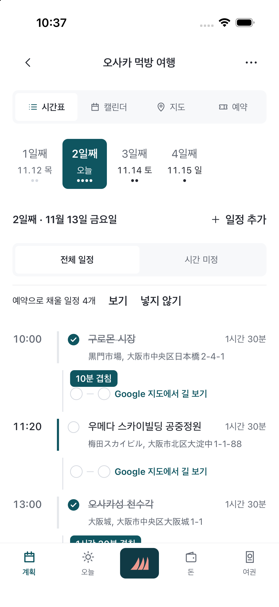
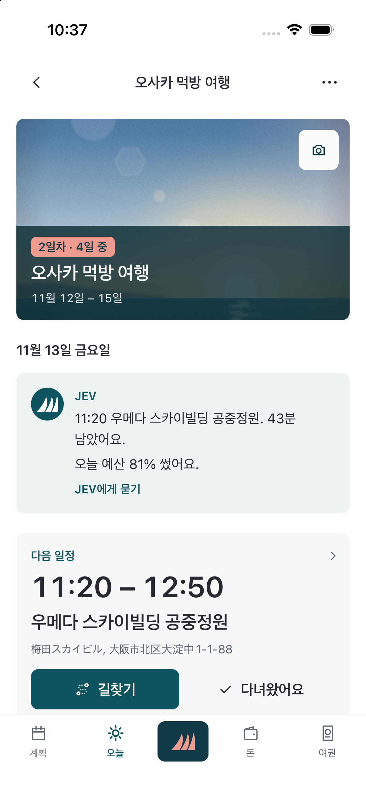
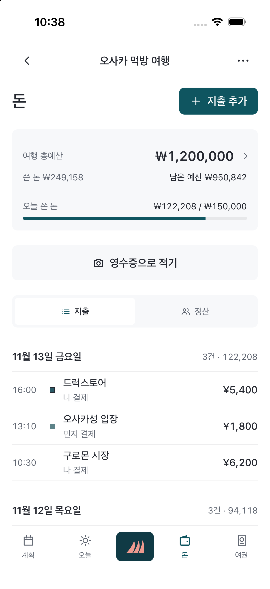
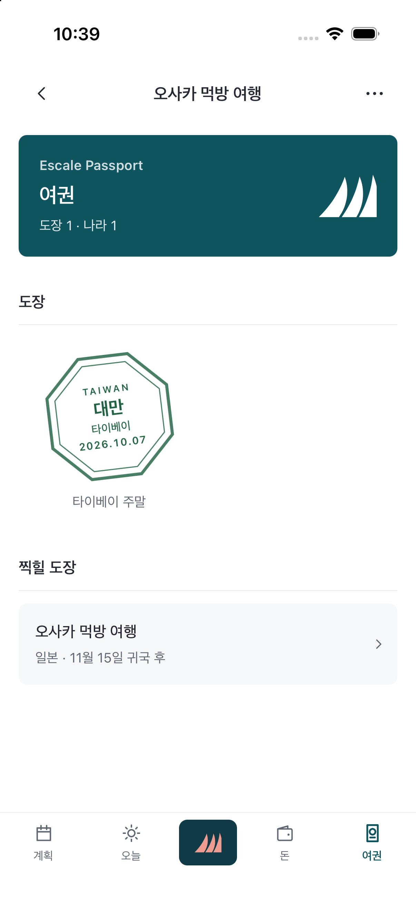

# Escale

**계획부터 귀국까지, 여행의 다음 행동을 한곳에서.**

Escale(에스칼, 프랑스어로 "기항지")은 혼자 여행을 준비하는 사람을 위한 iOS/Android 여행 앱이다. 여행 전에는 일정과 예약을 정리하고, 여행 중에는 다음 일정과 남은 예산을 확인하고, 귀국하면 여행을 여권 도장으로 남긴다.

| 계획 | 오늘 | 돈 | 여권 |
|---|---|---|---|
|  |  |  |  |

캡처는 2026-11-13 iOS 시뮬레이터에서 개발용 예시 여행으로 찍은 원본이다. 시각 디자인은 계속 다듬는 중이다. 촬영 조건은 [캡처 기록](docs/captures/README.md)에 있다.

## 해결하려는 문제

- 일정·예약·지도가 여러 앱에 흩어져 있어 이동 중에 "다음에 뭘 해야 하지?"를 바로 판단하기 어렵다.
- 여러 통화로 쓴 돈과 동행자와의 분담을 여행이 끝난 뒤 정산하기 번거롭다.
- 여행이 끝나면 준비에 들인 노력이 아무 흔적 없이 사라진다.

## 주요 기능

하단 탭은 **계획 / 오늘 / 돈 / 여권** 네 개다. 로그인 없이 기기 안(SQLite)에서 끝까지 동작한다.

- **계획:** 시간표·월간/주간 캘린더·지도·예약이 하나의 선택 날짜를 공유한다. 시간 미정 일정만 모아 볼 수 있다. 두 장소 사이 이동은 Google 지도 대중교통 길찾기로 넘긴다.
- **오늘:** 다음 일정, 길찾기, 날씨, 환율, 오늘 지출을 한 화면에 모은다. 외부 정보를 불러오지 못하면 추측값 대신 실패 상태를 보여 준다.
- **돈:** 예산, 여행 기간 안팎 지출, 현지·정산 통화 환산, 영수증 인식 초안, 동행자별 분담과 정산 기록. 실제 송금은 하지 않는다.
- **여권:** 귀국일에 여행을 성공으로 마쳤다고 확인하면 나라별 도장을 한 번 발급한다. 취소한 여행은 제외하고, 재실행이나 탭 전환으로 중복 발급하지 않는다.
- **JEV 안내:** "지금 출발해야 해요", "오늘 예산 70% 썼어요"처럼 현재 상태를 다음 행동으로 연결하는 한 목소리의 안내. 장소 추천은 Google Places 후보를 TypeSafe Jev 판단으로 거른다.

## 설계에서 신경 쓴 점

- **돈 계산:** 금액은 최소 화폐 단위 정수로 저장하고, 환율은 정수 분수로 계산해 반올림을 마지막에 한 번만 한다. 예: EUR 12.34를 1500 KRW/EUR로 입력하면 KRW 18,510. 남는 1원은 소수 부분이 큰 사람부터 배분한다.
- **시간대:** 일정은 여행별 IANA 시간대의 현지 시각으로 입력·표시한다. 시간대를 바꿔도 기존 일정의 실제 순간을 보존하고, DST로 없거나 중복되는 시각은 다시 입력을 요청한다.
- **데이터 보존:** 브랜드와 화면 구조를 여러 번 바꾸는 동안에도 기존 사용자 데이터, 백업 형식, DB 마이그레이션은 유지했다. 이 때문에 bundle ID(`com.travelpouch.notebook`)와 일부 저장 키에는 예전 이름이 남아 있다.
- **비밀키 경계:** Google Places, TypeSafe, Supabase 서비스 키는 서버(`api/`, `server/`)에만 두고 앱에는 공개 키만 넣는다. 로그인 없는 장소 조회에는 IP별·전체 하루 한도를 둔다.

## 기술 스택

- **앱:** Expo 57, React Native 0.86, React 19, TypeScript, expo-sqlite, 로컬 네이티브 모듈(영수증 인식)
- **서버:** Vercel Functions(`api/`), Google Places API (New), TypeSafe Jev, Supabase(선택적 계정·백업)
- **공유 도메인:** `src/domain/`의 돈·시간대·예약 계산을 앱과 서버, 예전 웹 버전이 함께 쓴다.
- **검증:** Vitest 도메인 테스트, TypeScript 타입 검사, Maestro e2e 시나리오(`mobile/e2e/`)

## 저장소 구조

```text
mobile/          Expo 앱 (현재 제품)
  App.tsx        여행 선택·탭·공유 날짜 연결
  src/screens/   여행 생성·계획·오늘·돈·여권 화면
  src/data/      로컬 모델·저장·정산·여권 발급 로직
  modules/       영수증 인식 등 네이티브 기능
api/, server/    Vercel 서버 함수와 Places·추천·예약 분석 로직
src/domain/      앱과 서버가 공유하는 돈·시간대·예약 계산
src/ (그 외)     초기 PWA 버전 (Osaka Pocket). 호환 데이터 참고용
docs/            설계·검증 기록
```

## 실행

Node.js 22를 기준으로 한다. 루트와 `mobile/` 양쪽 의존성이 필요하다.

```sh
npm ci
npm ci --prefix mobile
cp mobile/.env.example mobile/.env
cd mobile && npm run ios   # 또는 npm run android
```

지도·영수증 인식 같은 네이티브 기능은 Expo Go 대신 개발 빌드로 확인한다. 환경 변수와 서버 설정은 [모바일 README](mobile/README.md)와 루트 `.env.example`에 있다.

### 검사

```sh
npm test --prefix mobile
npm run typecheck --prefix mobile
npm test
npm run typecheck
```

Node 25에서 루트 테스트가 localStorage 충돌로 실패하면 `NODE_OPTIONS=--no-experimental-webstorage npm test`를 사용한다.

## 현재 상태

- **1단계 (혼자 완결):** 네 탭, 공유 날짜, 로컬 정산, 여권 발급 구현. 자동 검사와 iOS 시뮬레이터의 생성 → 일정 → 오늘 → 지출 → 정산 → 도장 흐름 확인 완료.
- **남은 검증:** 실기기, 실제 외부 API 응답 화면, 영수증 카메라, Android 실기기, 스토어 배포.
- **2단계 (함께):** 초대·역할·공동 편집·일정 댓글·공유 앨범. 미착수.
- **3단계 (스마트):** JEV 초안 적용·되돌리기, 코스, 위치 공유, 멤버십. 미착수.

자동 테스트 통과는 실기기나 배포 검증을 뜻하지 않는다. 항목별 구현·검증 범위는 [구현 진행보고](docs/구현_진행보고_escale.md)에 있다.

## 문서

- [Escale 통합 설계](docs/design/Escale_통합_설계.md): 목표, 범위, 사용자 흐름, 데이터 설계
- [구현 진행보고](docs/구현_진행보고_escale.md): 기능별 구현·검증 현황
- [모바일 README](mobile/README.md): 실행법, 환경 변수, 폴더 구조와 설계 이유

## 이름의 변화

이 저장소는 오사카 여행용 개인 PWA(Osaka Pocket)에서 시작해 여행 수첩 앱(Margin)을 거쳐 지금의 Escale이 됐다. 공개 저장소에는 현재 제품의 코드와 문서만 담았다. 이전 단계의 설계·검증 기록과 개인 여행 자료는 비공개 개발 저장소에 보관한다.
